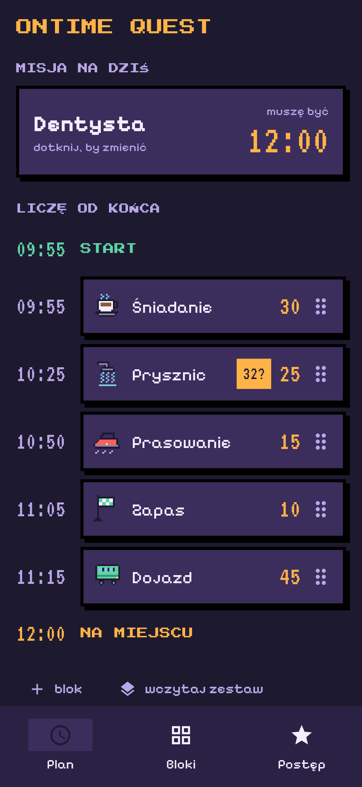
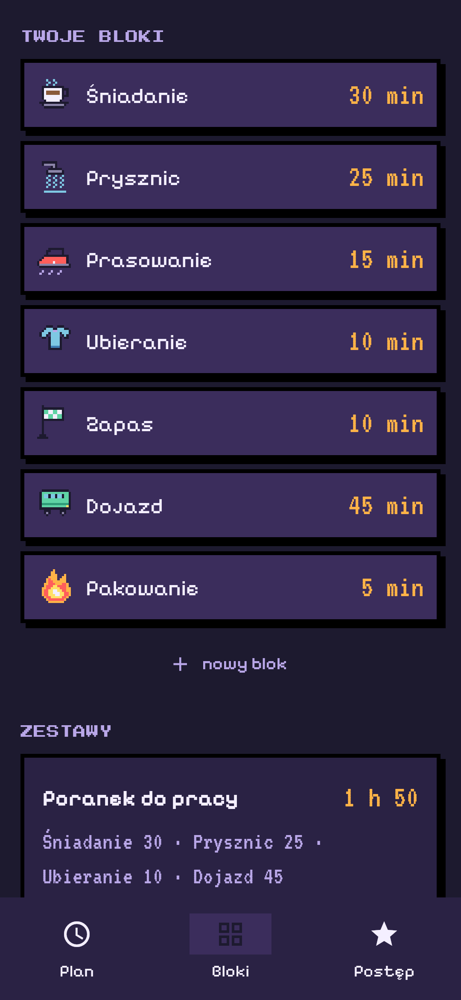
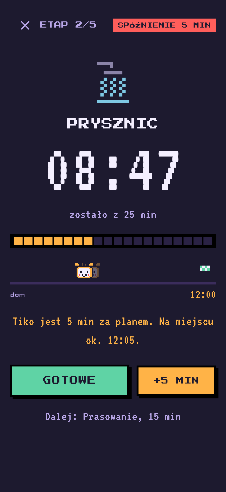
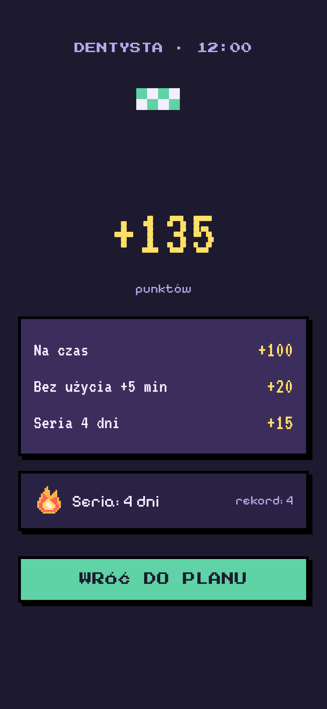

# OnTime Quest

A real-life game for people who are always late. You say when you must
**arrive**, the app plans your blocks backwards, tells you when to start, and
turns each block into a countdown stage with **Gotowe** (Done) and **+5 min**.

Android first, iOS later. Flutter, local storage only, no backend.
UI copy is Polish for the first friend test.

| Plan | Blocks & sets | Countdown | Arrival |
|---|---|---|---|
|  |  |  |  |

## Run it

Requires Flutter stable **3.50+** (Dart 3.14). Check with `flutter doctor`.

```bash
flutter pub get
flutter run            # pick an Android emulator or a phone with USB debugging
flutter test           # unit + widget tests
flutter analyze
flutter build apk      # debug-signed APK in build/app/outputs/flutter-apk/
```

> Note: since Flutter 3.4x the Material widgets come from the
> `material_ui` package (`import 'package:material_ui/material_ui.dart';`),
> not `package:flutter/material.dart`.

## What works

- **Plan backwards**: set the mission name and arrival time; the timeline
  shows when each block starts and the big "zacznij o" start time. If the
  start time has passed it tells you to go now.
- **Plan editing**: add blocks, load a saved set, drag to reorder, swipe to
  delete, tap a block to change its minutes for today only, save the plan as
  a new set.
- **Blocks & sets** tab: create/edit/delete reusable blocks (name, minutes,
  pixel icon) and ordered sets.
- **Countdown ("game")**: stage X/N, big timer, life bar, Tiko running on a
  track next to a ghost Tiko showing where you should be, "x min behind /
  ahead" with projected arrival, **Gotowe** and **+5 min**. The session is
  stored as timestamps, so it survives the app being killed and reopens on
  launch.
- **Arrival**: "Na czas?" -> points (100 on time, +20 without +5, +5 per
  streak day), streak and record. Being late only breaks the streak.
- **Duration learning (basic)**: every "Gotowe" stores the real duration.
  After 3+ runs, if the median of the last 7 differs by 3+ min, the plan shows
  an amber badge ("32?"); tap it to update the block.
- **Progress** tab: total points, streak, recent missions.

## Not done yet (next steps)

- Ongoing Android notification with **Gotowe / +5 min** actions and lock-screen
  countdown (`flutter_local_notifications` + foreground service), plus the
  "budzik" alarm before start.
- Sound / voice cues.
- Insight screen with the history chart (screen 6 of the mockups), levels.
- Choosing a different day than today/tomorrow, multiple missions per day.
- App icon, splash, final mascot art, English copy for the Play Store.

## Code map

```
lib/
  main.dart             app entry, wires LocalStore + AppState (provider)
  app.dart              MaterialApp + theme
  theme/                "Zmierzch" palette, fonts, ThemeData
  models/               Block, BlockSet, Plan/PlanStep, RunSession, history
  logic/planner.dart    planBackwards, suggestions, points, streaks (pure, tested)
  data/                 LocalStore (shared_preferences JSON) + starter data
  state/app_state.dart  the one ChangeNotifier screens talk to
  widgets/              pixel sprites, pixel buttons/panels, dialogs
  screens/              plan, blocks, set editor, countdown, arrival, progress
test/                   planner, app state, and a full-flow widget test
assets/fonts/           Press Start 2P, Pixelify Sans, VT323 (SIL OFL)
```

Pixel sprites (Tiko, block icons) are drawn from character grids in
`lib/widgets/pixel_sprite.dart`, copied from the mockups; swap for PNGs later.
