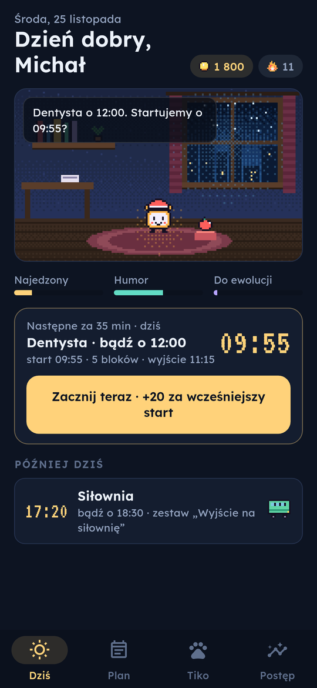
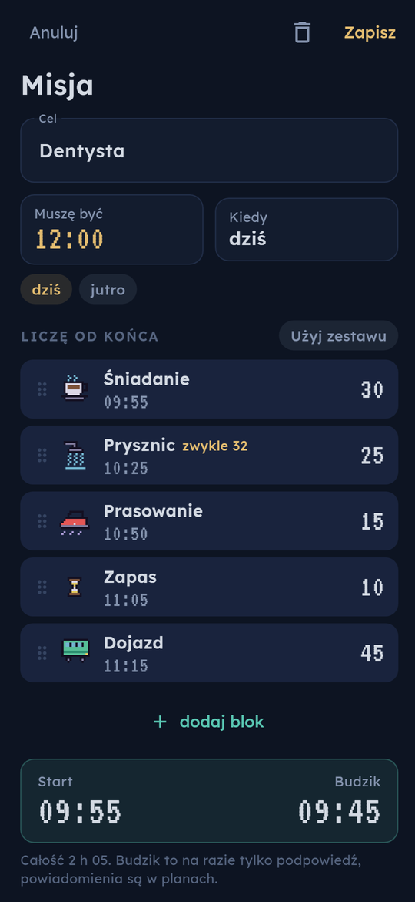
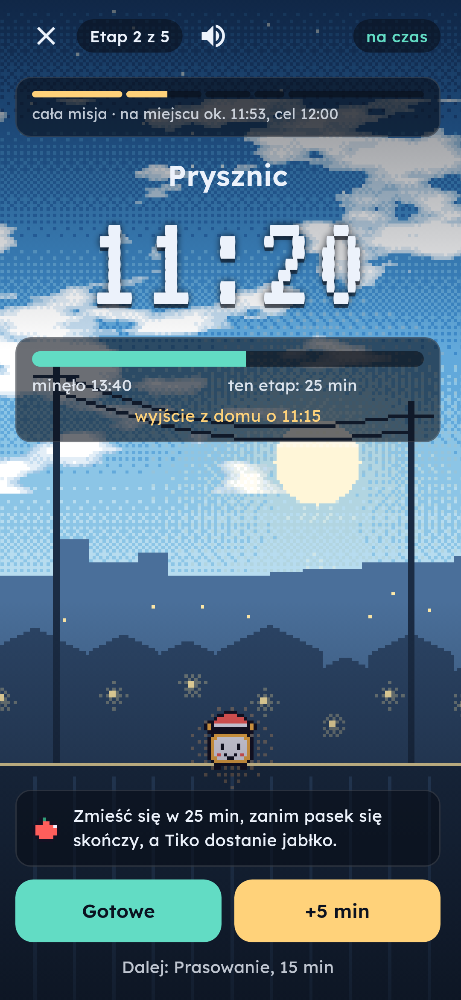
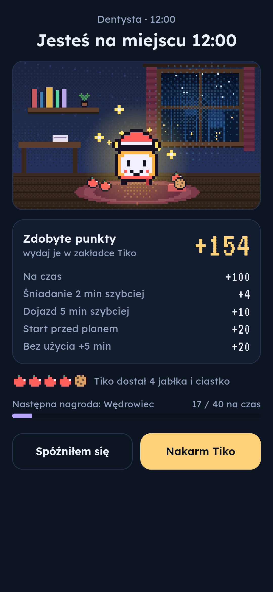
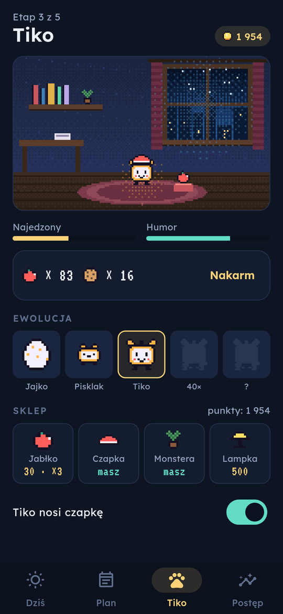
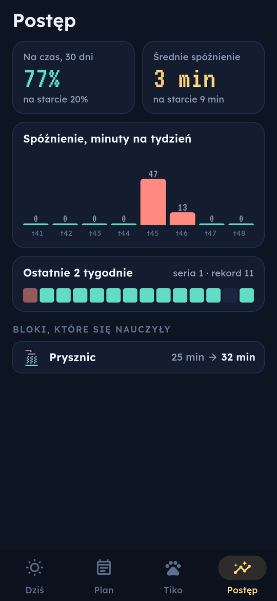

# OnTime Quest

A real-life game for people who are always late. You say when you must
**arrive**, the app plans your blocks backwards and tells you when to start.
Each block becomes a countdown stage with **Gotowe** (Done) and **+5 min**.
Arriving on time feeds and grows your companion, **Tiko**.

Android first, iOS later. Flutter, local storage only, no backend.
UI copy is in Polish for the first friend test.

| Today | Mission | Countdown | Reward | Tiko | Progress |
|---|---|---|---|---|---|
|  |  |  |  |  |  |

## Run it

Requires Flutter stable **3.50+** (Dart 3.14). Check with `flutter doctor`.

```bash
flutter pub get
flutter run            # pick an Android emulator or a phone with USB debugging
flutter test           # unit + widget tests
flutter analyze
flutter build apk      # debug-signed APK in build/app/outputs/flutter-apk/
```

> Since Flutter 3.4x the Material widgets come from the `material_ui`
> package (`import 'package:material_ui/material_ui.dart';`).

## What works

- **Onboarding:** your name, then pick a companion. Tiko is available now;
  Rudi (fox) and Garaż (car) are shown as "coming soon".
- **Dziś (Today):** Tiko's room, meters (fed, mood, to evolution), the next
  mission with its start time and "start now" (+20 if early), and later today.
- **Plan:** missions grouped by day. **New mission:** goal, arrival time,
  today/tomorrow/date, "use a set", blocks planned backwards (drag, swipe to
  delete, tap for minutes), a "zwykle 32" hint from history, and start + alarm.
- **Blocks & sets:** a library with a bottom sheet for icon, minutes, the
  history hint ("Ustaw 32", +15), and toggles (sound, allow +5).
- **Countdown:** a full-screen pixel street for the time of day
  (dawn/day/dusk/night), a big clock, end time and when to leave, and a
  small reward per stage (an apple). Gotowe / +5 min. Survives app restarts.
- **Sound:** chiptune jingles (block start, 2 min left, 3-2-1, time up,
  Gotowe, finish) synthesised in code, plus a Polish narrator: "Pan Zegarek"
  (male) or "Pani Minutka" (female), or none. Speaker icon on Dziś and on the
  countdown. See "Voice" below.
- **Reward:** on time is decided by the clock (the last block is the trip).
  Points are itemised: +100 on time, +2/min per block finished early (max 10),
  +20 early start, +20 without +5, +5/day streak (max 50). An honest
  "Spóźniłem się" gives +10. Food: an apple per block finished in time and a
  cookie for arriving on time.
- **Tiko:** feed, 5 evolution stages by on-time count (egg, chick at 1, Tiko
  at 15, Wanderer at 40, ??? at 100), and a shop (apples, hat, plant, lamp).
  Bought items show up in the room. No punishments: Tiko never dies or gets
  sick, and fullness never drops below 20%.
- **Postęp (Progress):** on-time % and average lateness (last 30 days vs your
  first 5 missions), minutes late per week, the last 2 weeks, and the blocks
  whose times were learned.

## Not done yet

- Android notification with Gotowe / +5 actions and the real alarm. Sounds
  only play while the countdown screen is open.
- Location-based arrival (it is a button for now).
- Real art: everything is placeholder pixel art drawn in code (`lib/art/`).
  This will be swapped for an AI-generated set later.
- Rudi and Garaż companions, more scenes and items, recurring missions.

## Voice

The lines live in `lib/audio/voice_lines.dart`, each with an id such as
`m_warn_1`. For now they are read by the phone's own Polish text-to-speech
(`flutter_tts`), with pitch and speed tuned per narrator; if Google's male
or female Polish voice is installed it is picked automatically.

To use recorded voices instead, drop files at
`assets/voice/male/<id>.mp3` or `assets/voice/female/<id>.mp3` and list
`assets/voice/male/` and `assets/voice/female/` under `assets:` in
`pubspec.yaml`. A clip is used when it exists; otherwise TTS reads the line.
Lines with `{name}` or `{min}` stay on TTS.

Tone rules for new lines: funny and warm, never shaming. Late means
"we can still make it".

## Code map

```
lib/
  main.dart, app.dart     entry, provider wiring, theme
  theme/                  design palette, Lexend/VT323, ts() text helper
  art/                    sprites, pixel canvas (dither, glow, clouds), scenes
  models/                 Block/BlockSet, Mission/PlanStep, RunSession,
                          CompanionState + stages + shop, history
  logic/                  planner (backwards, learning, streak), rewards, format
  audio/                  cue tracker, jingles, voice lines, sound player
  data/                   LocalStore (shared_preferences JSON) + starter data
  state/app_state.dart    the one ChangeNotifier screens talk to
  screens/                onboarding, today, missions, mission editor, blocks,
                          set editor, countdown, reward, companion, progress
test/                     planner + rewards, app state, full-flow widget tests
assets/fonts/             Lexend, VT323 (SIL OFL)
```
